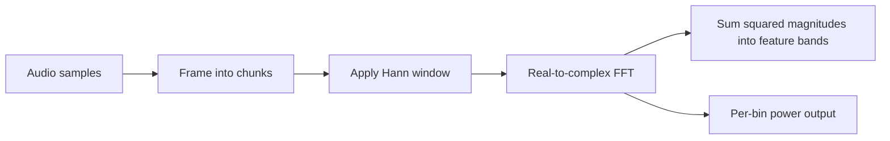

# DSP Pipeline

A Rust audio DSP example that divides samples into frames, applies a Hann
window, computes a real-valued forward FFT, and groups the resulting spectral
power into feature bands. Setup allocates reusable processing buffers; frames
are processed into caller-owned output storage.

## Architecture



Incomplete trailing frames are discarded. Processing buffers are reused across
frames, and results are written to caller-provided output storage.

## Run

Run the demo from the repository root:

```sh
cargo run --manifest-path dsp/Cargo.toml
```

Run the test suite:

```sh
cargo test --manifest-path dsp/Cargo.toml
```

Run only the framing integration tests:

```sh
cargo test --manifest-path dsp/Cargo.toml --test framing_tests
```

## File guide

### Repository root

- `README.md` — Project overview, run/test commands, and this guide to the
  project files.

### `dsp/`

- `Cargo.toml` — Crate metadata and Rust dependency declarations.
- `Cargo.lock` — Locked dependency versions to make application builds
  reproducible.

#### `dsp/src/`

- `lib.rs` — Declares the library modules and re-exports the main DSP types,
  helpers, and error type.
- `main.rs` — Demonstrates processing a simulated three-second sample buffer
  frame by frame and reports the number of processed frames.
- `framing.rs` — Provides an iterator and helper function for fixed-size
  borrowed audio frames; incomplete trailing frames are discarded.
- `window.rs` — Defines the DSP error type, creates periodic Hann coefficients,
  and applies a precomputed window into a caller-provided buffer.
- `spectrum.rs` — Wraps a real-to-complex forward FFT and reuses its output and
  scratch buffers between frames.
- `features.rs` — Divides FFT bins into bands and writes the summed squared
  magnitudes for each band into a caller-provided output buffer.
- `pipeline.rs` — Combines windowing, FFT, and feature extraction in
  `FramePipeline`; also provides `AudioPipeline` for per-bin power output.

#### `dsp/tests/`

- `framing_tests.rs` — Checks overlapping frames, incomplete tails, exact and
  undersized inputs, large hops, and zero-size argument rejection.
- `pipeline_tests.rs` — Checks that silence yields zero power, a sine wave
  yields finite nonnegative power, and sequential frames are processed.
- `window_tests.rs` — Contains a test case for mismatched input and window
  lengths when applying a window.

Cargo's generated `target/` directory contains build artifacts and is not
project source.
